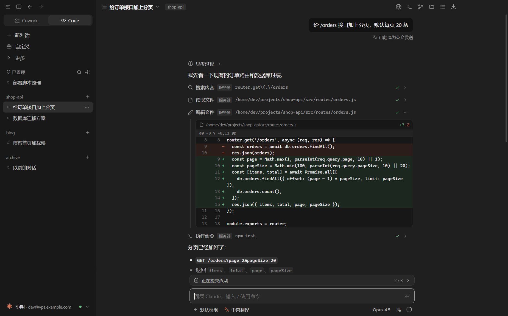
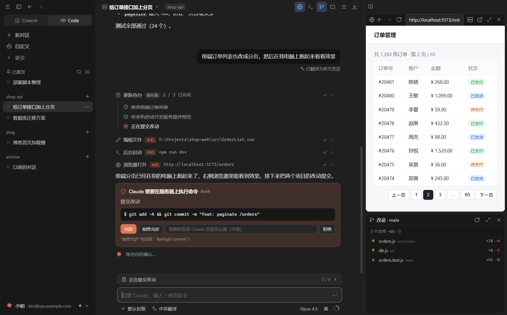
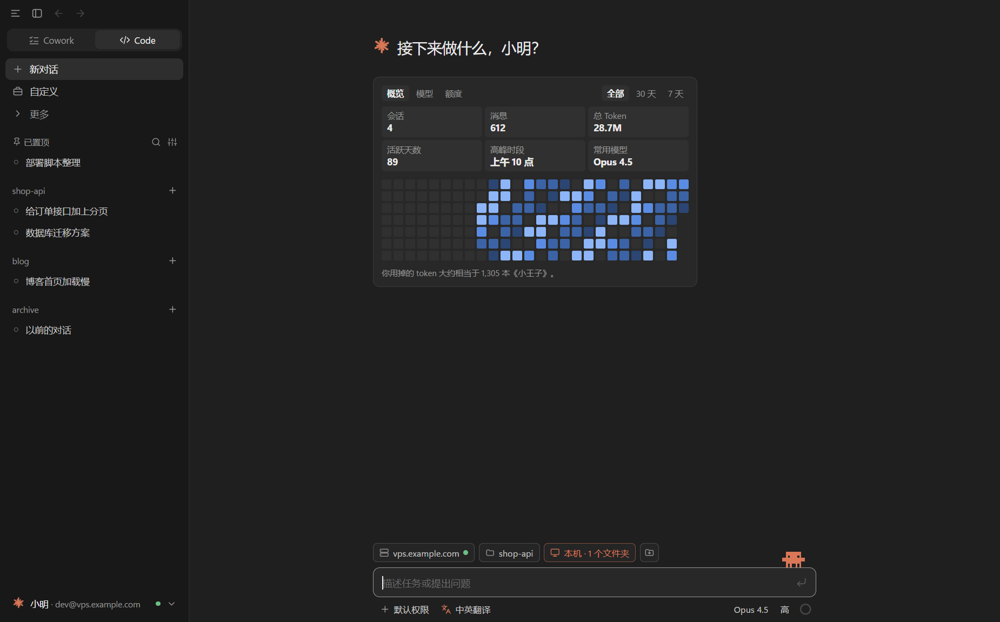
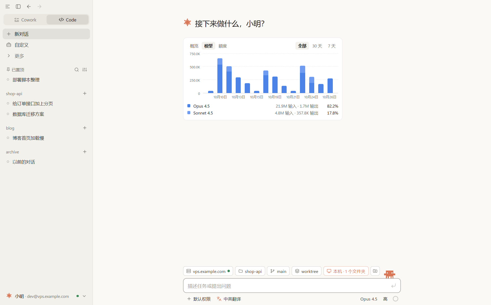
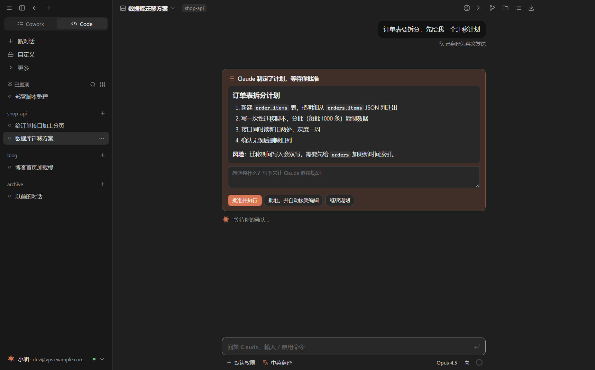
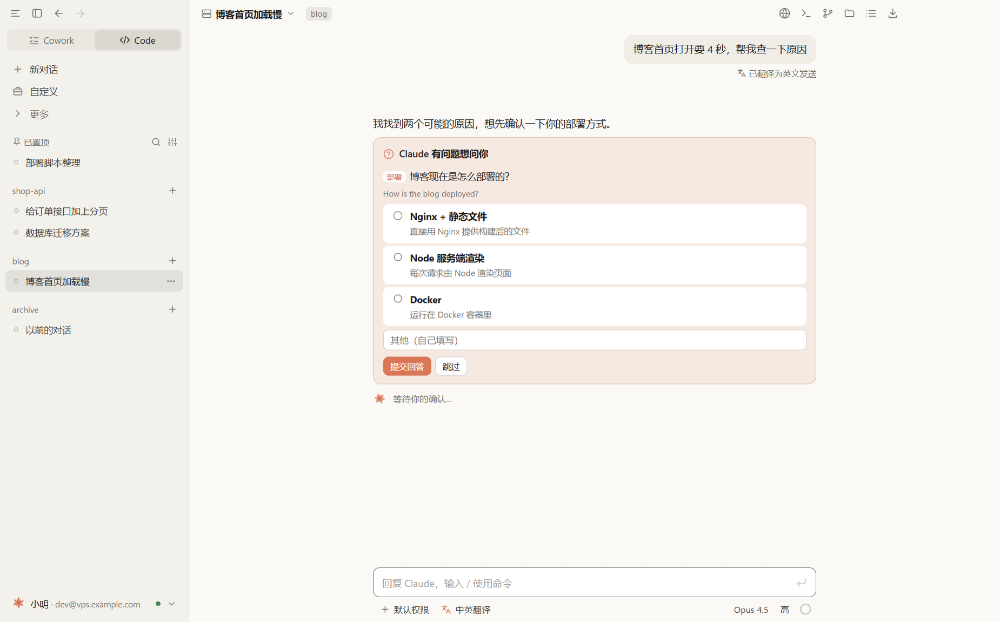

# Claude Bridge

在 Windows 上通过 SSH 使用 VPS 上的 [Claude Code](https://docs.claude.com/en/docs/claude-code/overview)，界面仿 Claude 桌面版（Code 页）。

- **你 → 服务器**：在本机和服务器上的 Claude 对话，Claude 在服务器上读写代码、执行命令。
- **服务器 → 你**：通过 SSH 反向隧道 + MCP，服务器上的 Claude 可以操作你本机共享的文件夹、在本机启动开发服务器、用内置浏览器预览网页，开启后还能控制桌面。
- **中英双向翻译**：中文输入自动翻成英文发给 Claude，英文回复翻成中文显示，随时可看原文。

> 本项目与 Anthropic 无关，不是官方产品。“Claude”是 Anthropic 的商标。使用时需要遵守 Anthropic 的使用条款。

## 截图

> 截图里的服务器、项目和对话都是演示数据，由 [`scripts/screenshots.js`](scripts/screenshots.js) 生成。





<table>
  <tr>
    <td></td>
    <td></td>
  </tr>
  <tr>
    <td align="center">首页统计</td>
    <td align="center">模型用量（浅色主题）</td>
  </tr>
  <tr>
    <td></td>
    <td></td>
  </tr>
  <tr>
    <td align="center">计划审批</td>
    <td align="center">Claude 的提问（浅色主题）</td>
  </tr>
</table>

## 下载

到 [Releases](https://github.com/HEYD66/claude-bridge/releases) 下载：

| 文件 | 说明 |
|---|---|
| `Claude-Bridge-Setup-x.y.z.exe` | 安装包（推荐）：启动快，有开始菜单和桌面快捷方式，可在“应用”里卸载 |
| `Claude-Bridge-x.y.z-portable.exe` | 免安装版：双击直接运行，每次启动会先解压，稍慢 |

两者共用同一份设置和对话记录（`%APPDATA%\Claude Bridge`）。

程序没有代码签名，第一次运行时 Windows 可能提示“Windows 已保护你的电脑”，点“更多信息 → 仍要运行”。

## 准备

- Windows 10 / 11（x64）
- 一台 Linux 服务器（VPS），已安装并登录 Claude Code
  - 需要 bash、GNU coreutils；sshd 不能禁用 `AllowTcpForwarding`（本机访问靠反向隧道）
  - 以 root 运行时，Claude Code 不允许 bypassPermissions 模式
- 翻译（可选）：任意 OpenAI 兼容的大模型接口（如 DeepSeek、通义千问），或 DeepL、百度翻译的 API Key
- 桌面控制（可选）：本机安装 [uv](https://docs.astral.sh/uv/)

## 快速开始

1. 打开程序，在 **设置 › 服务器** 填写地址、端口、用户名和密码（或私钥），点“保存并连接”，核对并信任服务器指纹。
2. **设置 › Claude** 里点“自动检测”找到服务器上的 `claude`。还没登录的话，左下角账号菜单 →“登录服务器上的 Claude…”，在内置终端里完成登录。
3. **设置 › 翻译** 填翻译服务的 API Key（不需要翻译可以关掉）。
4. 想让 Claude 操作本机：点输入框上方的文件夹按钮共享文件夹；需要它在本机执行命令、启动开发服务器时，在 **设置 › 本机访问** 打开“允许执行 PowerShell 命令”。

## 主要功能

- **对话**：服务器上常驻 Claude Code 进程，断网或关闭程序任务也会继续，重连后自动接回；运行中可排队或 Ctrl+Enter 插话，Esc 停止。
- **审批**：权限请求、Claude 的提问、计划都在对话里以卡片显示；“始终允许”写入项目规则。
- **历史**：编辑消息、重新生成、版本切换，回退到某条消息之前（同时撤销 Claude 对文件的修改）。
- **可视化**：工具调用、diff、待办、子代理、上下文占用、订阅额度（仅订阅账号）。
- **右侧面板**：内置浏览器、终端、Git 改动、服务器文件（树形 + 搜索）、本机操作记录，可上下排列或左右并排。
- **本机开发**：Claude 可以在本机后台启动 `npm run dev` 等服务，并用内置浏览器打开、读取、点击、输入、截图、查看控制台。
- **其它**：Cowork 模式（Windows-MCP 桌面控制）、导入服务器上已有的会话、全文搜索、置顶、多窗口、图片、自定义页（CLAUDE.md、技能、子代理、输出风格、权限规则、Hooks、MCP 连接器、插件）。

## 安全说明

- 密码、私钥口令、API Key 用 Windows DPAPI 加密保存在本机。
- 本机 MCP 服务只监听 `127.0.0.1` 的随机端口，经 SSH 反向隧道只暴露给服务器的 `127.0.0.1`，并且要求随机令牌。
- 服务器上的 Claude 只能访问你共享的文件夹；写入、删除、执行命令前可以要求逐项确认（设置 › 本机访问），所有操作记录在“本机操作记录”里。
- 内置浏览器使用独立存储，不带系统浏览器的登录状态，只能打开 http / https；打开外部网站前会询问。
- 首次连接服务器要求确认主机指纹，指纹变化会警告。

## 从源码运行 / 打包

```powershell
npm install
npm start        # 开发运行
npm run dist     # 打包到 dist/：安装包 + 免安装版
```

开发相关的说明（架构、设计决策、协议笔记、测试方法）见 [`交接文档.md`](交接文档.md)。

## 已知限制

- Fast 模式在 Claude Code 的 SDK 模式下不可用。
- 程序没有自动更新；Claude Code 本身可以在内置终端里 `claude update`。
- 只在 Linux 服务器上测试过（需要 GNU 版 `tail`、`stat`）。
